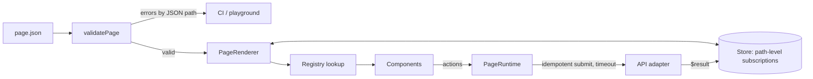

# Payloom

**Schema-driven UI platform for payment pages.** Payment flows are written as JSON configs. A validator checks each config against a registry of accessible React components, and a small runtime handles state, validation, retries and idempotent submits. A new checkout needs a config, not a new codebase.

**Live demo: https://payloom.vercel.app** · sample pages, a live config playground, and component docs generated from the registry.

    

Built from scratch: no UI library, no form library, no state library. The only runtime dependency is React.

---

## Why

Payment teams ship many near-identical pages: checkout, add card, bill pay, top-up, OTP. Each needs the same hard parts done right every time: no double charges, correct validation, clear errors, accessibility, and a fast experience on cheap phones. Payloom puts those parts in one platform and lets each page be data:

```json
{
  "type": "Button",
  "props": { "label": "Pay {{ total | inr }}" },
  "action": {
    "type": "submit",
    "endpoint": "payments/create",
    "payload": ["method", "upi", "card"],
    "onSuccess": { "type": "set", "path": "step", "value": "done" }
  }
}
```

## How a page renders



| Layer | File | What it does |
|---|---|---|
| Expression language | `src/engine/expr.ts` | Tokenizer + Pratt parser for `when` conditions and `{{ }}` templates. No `eval`; member access is limited to own data properties, so configs cannot reach prototypes or globals. Reports the dependencies of each expression. |
| Validator | `src/engine/validate.ts` | Checks the whole config before render: component types, prop types and enums, required props, bindings, rules, actions, expressions, duplicate ids, theme contrast. Every issue has a JSON pointer (`/body/2/children/0/props/tone`) and "did you mean" hints. |
| Store | `src/engine/store.ts` | Immutable state with path-level subscriptions. A write to `upi` wakes only readers of `upi`. |
| Renderer | `src/engine/Renderer.tsx` | Resolves each node through the registry, subscribes it to exactly the paths its `when`, templates and `bind` read, and wraps it in its own error boundary. |
| Runtime | `src/engine/runtime.ts` | Field registration and rules, submit flow, idempotency keys, timeouts, action chains. |
| Registry | `src/engine/registry.ts` | Typed component specs. The same spec drives validation, the docs page and the a11y tests. Teams add components with `registry.extend().register(...)`. |
| Tokens | `src/tokens/tokens.ts` | Light/dark palettes, radius and density as `--pl-*` custom properties; per-page brand accents with automatic on-accent text colour. |

## Guarantees (each one is tested)

**Correct under failure**
- A submit cannot run twice: double clicks, repeated Enter presses and clicks while a request is in flight are dropped (`duplicate_blocked`).
- Every submit carries an idempotency key. **Retrying the same payload reuses the key**, so the server can dedupe; changing the payload mints a new key.
- Requests time out (configurable, default 15 s) into a retryable error. The request is aborted, and the customer is told the payment was not confirmed.
- Every node renders inside its own error boundary: a crashing component shows a small fallback and emits `node_error`, and the rest of the payment page keeps working.
- Only fields currently on screen are validated: an empty card form never blocks a UPI payment.

**Fast by construction**
- Typing in a field re-renders that field only. The test suite asserts it (`re-renders only the field being typed in`), and the demo's "Show re-renders" toggle flashes each node as it renders.
- The engine and all 25 components come to **25 kB gzipped** (`npm run build:lib`). The demo site splits the playground and docs into their own chunks.

**Accessible**
- axe-core runs in CI on every component example, every component's error state, and every sample page in its initial, failed-submit, per-method and success states. 0 violations.
- Text/background token pairs are checked to WCAG AA (4.5:1) in both themes, and so are per-page brand accents.
- Native radios in a fieldset/legend (arrow keys work as screen reader users expect), OTP boxes labelled "Digit 2 of 6", errors tied in with `aria-describedby`, focus moved to the first invalid field on submit and to the result heading on success, a GOV.UK-style error summary with links to each field, `aria-disabled` (not `disabled`) on busy buttons so focus is not lost mid-payment.

**Payment-specific inputs**
- Card number: brand detection (Visa, Mastercard, RuPay, Amex), brand-specific spacing (4-6-5 for Amex), caret-safe formatting, Luhn check, digits-only storage.
- CVV sized by brand (4 for Amex), expiry with automatic slash and month padding, UPI ID / IFSC / Indian mobile rules.
- Amount input with Indian digit grouping as you type (₹1,00,000.50) and quick-pick chips.
- OTP: auto-advance, backspace to the previous box, paste and SMS autofill (`one-time-code`) fill every box.

## Components

Payment: `Merchant`, `OrderSummary`, `Amount`, `PaymentStatus`, `CardNumberField`, `ExpiryField`, `CvvField`
Input: `TextField`, `AmountField`, `SelectField`, `RadioCards`, `Checkbox`, `OtpField`
Action: `Button`, `ResendTimer`
Feedback: `Alert`, `ErrorSummary`, `Steps`
Content: `Heading`, `Text`, `Badge`, `KeyValue`
Layout: `Stack`, `Card`, `Divider`

Full props for each are on the [docs page](https://payloom.vercel.app/#/components), generated from the registry.

## Sample pages

| Page | Shows |
|---|---|
| [`checkout.json`](src/pages/checkout.json) | UPI, card and netbanking with conditional fields; decline (`fail@upi`, card `4000 0000 0000 0002`), timeout (`timeout@upi`), retry with the same key |
| [`bill-pay.json`](src/pages/bill-pay.json) | Fetch → review → pay in one config; the fetched bill is written into state by `onSuccess` |
| [`wallet-topup.json`](src/pages/wallet-topup.json) | Live computed balance, amount presets, a brand accent |
| [`otp.json`](src/pages/otp.json) | 6-box OTP, resend countdown, retryable error (demo code `123456`) |

The demo's backend is an in-browser mock (`src/app/mockApi.ts`) that honours idempotency keys like a real payments API: a replayed key returns the original result without charging again.

## Using it

```tsx
// Not on npm yet: import from src/index.ts (or the dist-lib build)
import { PageRenderer, defaultRegistry, validatePage } from './payloom'
import checkout from './checkout.json'

const result = validatePage(checkout, defaultRegistry)
if (!result.ok) throw new Error(result.errors.map((e) => `${e.path}: ${e.message}`).join('\n'))

<PageRenderer
  page={result.page!}
  registry={defaultRegistry}
  api={({ endpoint, payload, idempotencyKey, signal }) =>
    fetch(`/api/${endpoint}`, {
      method: 'POST',
      headers: { 'Content-Type': 'application/json', 'Idempotency-Key': idempotencyKey },
      body: JSON.stringify(payload),
      signal,
    }).then((r) => (r.ok ? r.json() : Promise.reject(new Error('Payment failed'))))
  }
  onEvent={(e) => analytics.track(e.type, e)}
/>
```

Add a team's own component:

```tsx
const registry = defaultRegistry.extend().register({
  type: 'Cashback',
  category: 'Payment',
  description: 'Promo banner',
  props: { amount: { type: 'number', required: true, description: 'Rupees' } },
  example: { type: 'Cashback', props: { amount: 50 } },
  component: ({ props }) => <p>Get ₹{props.amount} cashback</p>,
})
```

## Development

```bash
npm install
npm run dev        # demo site
npm test           # 120 tests: engine, validator, renderer, components, axe, token contrast
npm run typecheck
npm run build      # demo site
npm run build:lib  # engine + components as an ES library
```

CI (GitHub Actions) runs the type check, the full test suite and the build on every push.

## Project layout

```
src/
  engine/       expression language, templates, rules, store, validator, runtime, renderer
  components/   25 components + their registry specs, components.css
  tokens/       design tokens and contrast checks
  pages/        sample page configs (JSON)
  app/          demo site: overview, gallery, playground, docs, mock API
  test/         axe accessibility suite, component keyboard tests
```

## License

MIT © Lovjyot Singh
